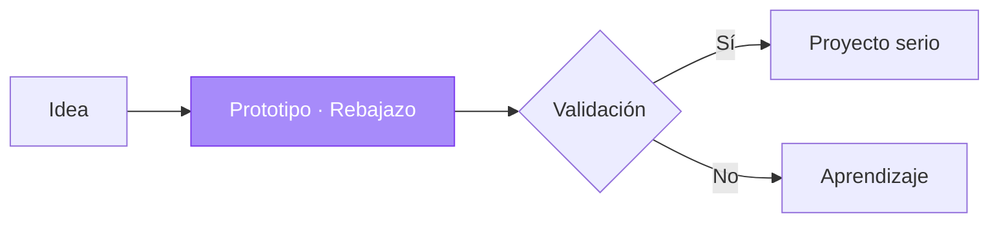

<div align="center">
  

  # Rebajazo

  **Un laboratorio de comercio electrónico. Una experiencia de compra, construida para experimentar.**

  *Recorre una compra completa sin mover un solo peso. Parte del garage de ingeniería de RDSA-699.*
</div>

<div align="center">

  <a href="https://github.com/RDSA-699/RDSA-699">← Volver al garage RDSA-699</a>

</div>

<br />

<div align="center">

  <a href="https://rebajazo-v2.netlify.app/" target="_blank">
    
  </a>

  <br />

  <sub>Un prototipo interactivo para explorar el recorrido completo de una compra online.</sub>

</div>

<br />

<div align="center">

  <a href="#sobre-este-prototipo">Proyecto</a> ·
  <a href="#exploración">Exploración</a> ·
  <a href="#tecnologías">Tecnologías</a> ·
  <a href="#ejecución-local">Instalación</a> ·
  <a href="#arquitectura">Arquitectura</a> ·
  <a href="#estado-del-proyecto">Estado</a> ·
  <a href="#reglas-del-garage">Reglas</a>

</div>

<br />

<div align="center">

  
  
  
  

</div>

* * *

## Sobre este prototipo

**Rebajazo** es un experimento de producto enfocado en explorar cómo podría funcionar una tienda online orientada al mercado colombiano. Nace en el garage de RDSA-699 con una pregunta sencilla: antes de construir una tienda real, ¿qué tan bien se entiende el recorrido completo de una compra?

El proyecto reúne en una sola experiencia las principales etapas del comercio electrónico: descubrimiento de productos, navegación por el catálogo, gestión del carrito, proceso de compra, confirmación y seguimiento de pedidos.

Pero Rebajazo no es únicamente una interfaz de tienda. También es un espacio para experimentar con decisiones de diseño, interacción, organización del código y flujos comerciales antes de invertir en una implementación completa.

Nace de una filosofía sencilla:

> **Construir para aprender. Experimentar para validar. Mejorar antes de escalar.**

### El enfoque de RDSA-699

Este proyecto forma parte de una forma de trabajar en la que las ideas se convierten en prototipos, los prototipos se someten a evaluación y solo las propuestas que lo justifican avanzan hacia una implementación más sólida.

En el garage, ese recorrido es **idea → prototipo → validación → proyecto serio**, y Rebajazo está en la etapa de prototipo.

Rebajazo permite explorar una experiencia comercial completa sin presentar como reales los servicios que todavía no existen.

- **Experimentación:** probar interfaces y recorridos de usuario.
- **Validación:** identificar problemas de usabilidad y oportunidades de mejora.
- **Iteración:** ajustar la experiencia a partir de los resultados.
- **Evolución:** establecer una base para una posible versión conectada a servicios reales.

### Un proyecto experimental, no una operación comercial

Los productos, precios, reseñas, pedidos y estados logísticos se utilizan con fines demostrativos. Las operaciones de pago son simuladas y no existe un backend comercial integrado.

La demo permite explorar el comportamiento de la interfaz, pero no representa una tienda preparada para procesar transacciones reales.

**Lo que no vas a encontrar:** backend, base de datos, autenticación, pagos reales, inventario ni logística. Tampoco código listo para producción ni garantías de que compile en tu máquina sin ajustes.

* * *

## Del garage al producto



Cada idea del garage sigue el mismo recorrido. Si sobrevive a la validación, sale de aquí y se convierte en un repositorio con arquitectura, documentación y seguridad desde el diseño. Si no, habrá cumplido su función: enseñar algo antes de gastar semanas en una implementación.

Rebajazo está en la etapa de **prototipo**. Lo que falta para salir del garage está en [Límites conocidos](#límites-conocidos).

* * *

## Exploración

### Experiencia de compra

- Página de inicio con ofertas, categorías y productos destacados.
- Catálogo con filtros por categoría y búsqueda global.
- Fichas de producto con descripciones, especificaciones, stock, variantes y reseñas.
- Carrito lateral con gestión de cantidades, variantes, subtotal, envío y cupones de demostración.
- Lista de favoritos persistida en el navegador.
- Checkout con datos de entrega y métodos de pago simulados:
  - Contraentrega.
  - Nequi y Daviplata.
  - PSE.
  - Tarjetas débito y crédito.
- Confirmación del pedido y generación de mensajes para WhatsApp.

### Seguimiento y operaciones

- Consulta de pedidos mediante códigos de demostración, como `RBZ-84920`.
- Línea de tiempo para visualizar estados de despacho.
- Accesos de contacto y soporte por WhatsApp.
- Vistas informativas sobre la tienda, el contacto y las condiciones de atención.
- Vista de etiquetas de envío para explorar posibles flujos operativos internos.

### Persistencia en el navegador

El carrito y los favoritos utilizan `localStorage` para conservar su estado al recargar la aplicación en el mismo navegador.

Esta persistencia es local: no implica sincronización entre dispositivos, cuentas de usuario ni almacenamiento en un servidor.

* * *

## Tecnologías

<div align="center">

  
  
  
  
  

</div>

La aplicación utiliza una arquitectura SPA basada en React, componentes funcionales, TypeScript, estado local y datos estáticos para representar los principales recorridos de compra.

Las tecnologías y versiones indicadas corresponden a las declaradas en la documentación del proyecto y deben contrastarse con `package.json` antes de actualizar dependencias o reproducir el entorno.

* * *

## Ejecución local

### Requisitos

- Node.js 20 o superior.
- npm.

### Instalación

Clona el repositorio y accede a su directorio:

```bash
git clone https://github.com/RDSA-699/Rebajazo.git
cd Rebajazo
```

Instala las dependencias:

```bash
npm install --legacy-peer-deps
```

El uso de `--legacy-peer-deps` responde a la configuración de dependencias documentada para este prototipo. Si esta condición cambia, conviene revisar las dependencias antes de mantener el indicador.

### Entorno de desarrollo

```bash
npm run dev
```

Abre en el navegador la dirección local indicada por Vite. Según la configuración actual, debería ser:

`http://localhost:3000`

### Validaciones

```bash
# Comprobación de tipos y código mediante el script lint
npm run lint

# Compilación de producción
npm run build

# Vista previa de la compilación
npm run preview
```

La disponibilidad y el alcance de estos comandos dependen de los scripts declarados en `package.json`.

### Variables de entorno

El archivo `.env.example` documenta las variables `GEMINI_API_KEY` y `APP_URL` para los entornos que requieran integración con servicios de IA o configuración de la aplicación.

La experiencia principal funciona con datos locales y no necesita credenciales para ejecutarse.

**Seguridad:** no publiques claves, tokens, credenciales ni archivos `.env` con valores privados. Los secretos deben gestionarse mediante variables de entorno protegidas en el entorno correspondiente.

> Este prototipo no garantiza que compile en todos los entornos. Si algo falla, el primer paso es revisar la versión de Node.js y las dependencias.

* * *

## Arquitectura

La organización del proyecto separa la interfaz, los recursos visuales, los datos de demostración, las utilidades y los tipos de datos.

```text
.
├── public/
│   └── img/                 # Recursos públicos y logo
├── src/
│   ├── assets/images/       # Imágenes de productos y portada
│   ├── components/          # Vistas y componentes de interfaz
│   │   └── admin/           # Componentes de operaciones y envíos
│   ├── data/                # Productos, reseñas y pedidos demo
│   ├── utils/               # Formateadores y mensajes de pedido
│   ├── App.tsx              # Estado global y navegación
│   ├── index.css            # Estilos globales
│   └── types.ts             # Tipos y contratos de datos
├── index.html
├── package.json
├── tsconfig.json
└── vite.config.ts
```

Esta estructura permite explorar la experiencia de usuario sin exigir una infraestructura de servidor desde el inicio.

No implica que todas las responsabilidades estén desacopladas de forma definitiva: la arquitectura puede evolucionar si el prototipo incorpora servicios externos, persistencia remota o funcionalidades comerciales reales.

* * *

## Estado del proyecto

Rebajazo se mantiene como un prototipo funcional de exploración. La siguiente tabla diferencia el alcance documentado de los componentes que todavía requerirían una implementación de producción.

| Área | Estado |
|:---|:---|
| Navegación y diseño adaptable | Implementado según el alcance del prototipo |
| Catálogo y búsqueda | Datos locales |
| Carrito y favoritos | Persistencia mediante `localStorage` |
| Checkout | Flujo visual y validaciones de formulario |
| Pagos | Simulados; no procesan dinero |
| Pedidos | Datos de demostración |
| Seguimiento | Códigos y estados de ejemplo |
| WhatsApp | Generación de enlaces y mensajes |
| Backend y autenticación | No incluidos |
| Base de datos remota | No incluida |
| Inventario y logística reales | No incluidos |

### Límites conocidos

El proyecto no debe utilizarse directamente para gestionar operaciones comerciales reales.

Antes de convertirlo en un producto, sería necesario evaluar e implementar, como mínimo:

1. **Backend y datos:** crear una API, una base de datos y un modelo de permisos adecuado.
2. **Identidad y acceso:** implementar autenticación y autorización si el producto lo requiere.
3. **Pagos:** integrar un proveedor de pagos mediante sus mecanismos oficiales, verificar las transacciones en el servidor y evitar almacenar datos sensibles de tarjetas.
4. **Pedidos e inventario:** sustituir los datos estáticos por registros persistentes y procesos coherentes.
5. **Privacidad:** proteger los datos personales y definir las políticas y obligaciones legales aplicables en Colombia.
6. **Calidad:** incorporar pruebas automatizadas, análisis estático, revisión de dependencias y validaciones de compilación.
7. **Operación:** añadir registro de errores, monitorización, copias de seguridad y mecanismos de recuperación.
8. **Experiencia:** evaluar accesibilidad, SEO, rendimiento y compatibilidad con dispositivos reales.

Estas tareas constituyen una hoja de ruta potencial, no funcionalidades que se consideren implementadas.

* * *

## Reglas del garage

Que sea un prototipo no significa que sea descuidado. Estas reglas son las mismas del garage y aplican aquí:

| Regla | Cómo se cumple en Rebajazo |
|:---|:---|
| **Sin secretos** | Nada de claves, tokens ni `.env` con valores reales en los commits. `.env.example` solo documenta nombres de variables. |
| **Sin datos personales** | Productos, reseñas, pedidos, cupones y códigos de seguimiento son de demostración. |
| **Todo con contexto** | Este README explica qué es el prototipo, en qué estado está y qué no hace. |
| **IA con revisión** | Lo generado con IA se trata como borrador hasta que se revisa y se prueba. |

* * *

## Filosofía de desarrollo

Rebajazo sigue los principios de experimentación de RDSA-699.

| Principio | Aplicación |
|:---|:---|
| **Experimentar antes de escalar** | Validar los recorridos de usuario antes de invertir en una infraestructura completa. |
| **Transparencia técnica** | Diferenciar las funciones implementadas de las simuladas y de las pendientes. |
| **IA como herramienta** | Tratar el código generado por IA como una propuesta que requiere revisión y pruebas. |
| **Seguridad desde el inicio** | Evitar secretos en el repositorio y evaluar los riesgos antes de integrar servicios. |
| **Iteración continua** | Utilizar cada versión como una oportunidad para detectar problemas y mejorar decisiones. |
| **Evolución responsable** | Promover el prototipo a producto únicamente cuando existan razones técnicas y de negocio para hacerlo. |

### Uso de inteligencia artificial

> **Sobre el uso de IA.** La IA es un lápiz más: sirve para bocetar y explorar alternativas rápido. El criterio técnico se queda con quien revisa.

Las herramientas de IA pueden facilitar la exploración de interfaces, la generación de componentes y la experimentación con alternativas de implementación.

Sin embargo, el código generado no se considera automáticamente correcto, seguro ni apto para producción.

Las modificaciones deben revisarse, probarse y contrastarse con los requisitos del proyecto. Las decisiones de arquitectura, seguridad y despliegue requieren validación explícita.

* * *

## Relación con RDSA-699

Rebajazo forma parte de un enfoque de desarrollo que prioriza la experimentación práctica y el aprendizaje acumulativo.

El objetivo de este tipo de proyectos no es presentar cada idea como un producto terminado, sino disponer de un espacio donde probar soluciones, comprender sus limitaciones y determinar qué merece evolucionar.

**Un prototipo no tiene que ser definitivo para ser útil. Tiene que permitir aprender algo que antes no sabíamos.**

* * *

Probar rápido, descartar sin culpa, promover lo que vale.

<div align="center">

  <a href="https://github.com/RDSA-699/RDSA-699"><strong>← Explorar el garage RDSA-699</strong></a>

  <br /><br />

  <sub>Rebajazo · Experimentar, validar y evolucionar.</sub>

</div>